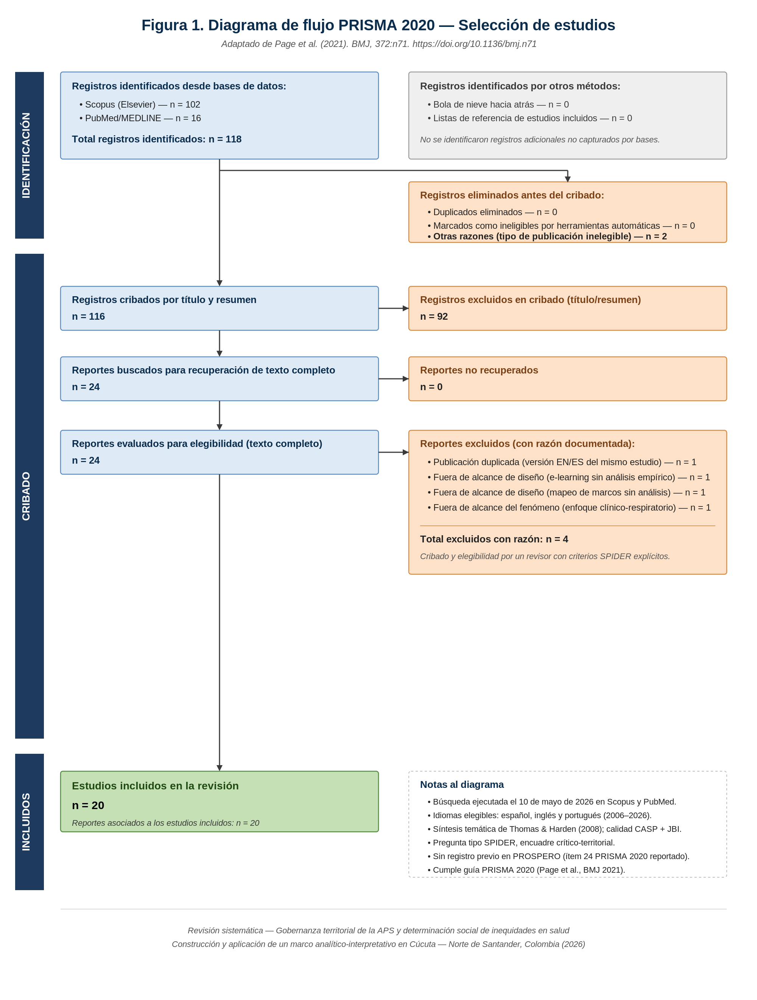

# 🧪 Metodología de generación de los datos

Volver a [INICIO](../INICIO.md).

## 📍 Contexto y propósito

Los datos se generaron en la revisión sistemática *"Gobernanza territorial de la Atención Primaria en Salud y determinación social de inequidades en salud: una síntesis temática crítica de la evidencia internacional (2006–2026)"*, producto académico vinculado a la tesis doctoral sobre Cúcuta–Norte de Santander. El propósito de la revisión es fundamentar empíricamente el marco analítico-interpretativo de la tesis.

- **Población objetivo (Sample):** sistemas, redes y servicios de APS y poblaciones territorialmente delimitadas (urbanas marginales, rurales, indígenas, migrantes, en pobreza estructural).
- **Fenómeno de interés:** arreglos de gobernanza territorial de la APS y su articulación con la determinación social de las inequidades en salud.
- **Cobertura temporal:** publicaciones del 1 de enero de 2006 al 10 de mayo de 2026.
- **Cobertura geográfica:** internacional, sin restricción de país.
- **Investigador principal:** Jose Fred Quiroz Ortega (autor único).

## 📐 Diseño

- **Tipo:** revisión sistemática con síntesis temática crítica, reportada según **PRISMA 2020** (Page et al., 2021).
- **Pregunta:** marco **SPIDER** — *¿Cómo configuran los arreglos de gobernanza territorial de la APS la determinación social de las inequidades en salud en poblaciones expuestas a desventajas estructurales, según la evidencia empírica internacional disponible entre 2006 y 2026?*
- **Registro del protocolo:** no registrado en PROSPERO (limitación declarada; ítem 24 PRISMA).

### Criterios de elegibilidad

| Inclusión | Exclusión |
|---|---|
| Estudios empíricos o revisiones que aborden **a la vez** (i) gobernanza/política/sistemas de salud, (ii) APS o acceso, (iii) inequidades/equidad/DSS | Editoriales, cartas, erratas, notas y comentarios sin diseño empírico |
| Publicados entre 01-01-2006 y 10-05-2026 | Fuera de la ventana temporal |
| Español, inglés o portugués | Otros idiomas sin traducción |
| Diseños cualitativos, mixtos, caso, análisis de política, etnografías, revisiones | Estudios estrictamente clínicos, biomédicos o de laboratorio |
| Texto completo o resumen estructurado suficiente | Duplicados; protocolos o herramientas sin análisis empírico |

## 📋 Procedimiento

1. **Búsqueda (10-05-2026)** — ecuaciones ejecutadas:
   - *Scopus:* `(TITLE-ABS-KEY("Primary Health Care") OR TITLE-ABS-KEY("Access to Primary Care") OR TITLE-ABS-KEY("Territorialization in Primary Health Care")) AND TITLE-ABS-KEY("Health Governance") AND TITLE-ABS-KEY("Health Inequities")`
   - *PubMed:* `("Primary Health Care"[MeSH] OR "Health Services Accessibility"[MeSH] OR "Primary Health Care"[tiab] OR "Access to Primary Care"[tiab]) AND ("Health Care Governance"[tiab] OR "Health Governance"[tiab]) AND ("Health Inequities"[MeSH] OR "Health Inequities"[tiab])`
   - Complemento: revisión manual de listas de referencias y búsqueda dirigida en Google Scholar (literatura gris OMS/OPS/Banco Mundial); sin registros adicionales.
2. **Gestión de registros** — exportación en CSV a un libro de trabajo único; deduplicación por DOI y, en su defecto, por título normalizado.
3. **Cribado en dos fases** — (1) título y resumen con criterios SPIDER; (2) texto completo, verificando los tres dominios. Motivos de exclusión registrados. Resultado en `flujo_prisma.csv`.
4. **Extracción** — matriz estructurada: identificación, país y escala, contexto, marco teórico, diseño, dispositivos de gobernanza, conceptualización de equidad, hallazgos y reflexión crítica.
5. **Evaluación de calidad** — CASP cualitativo, CASP revisión sistemática y JBI (política/transversal). Niveles: alta ≥ 80 % de criterios, moderada 50–79 %, baja < 50 %. Ningún estudio excluido por calidad.
6. **Síntesis** — Thomas y Harden (2008): codificación libre → temas descriptivos → seis temas analíticos; matriz PROGRESS-Plus.

## 🔧 Construcción de este dataset (pre-procesamiento)

- `estudios_incluidos.csv` se compiló a partir de la **Tabla 1** y la **lista de referencias** del manuscrito (versión del 11-05-2026).
- Se añadieron variables derivadas (`pais_iso3`, `region_oms`, `categoria_diseno`, `herramienta_calidad`, `en_lista_referencias`) con reglas explícitas descritas en [data_dictionary](data_dictionary.md).
- `flujo_prisma.csv` se construyó desde la sección 5.1 del manuscrito y la Figura 1.
- No hubo anonimización: los datos son metadatos bibliográficos públicos.

## 📎 Materiales de soporte

- [x] Diagrama PRISMA 2020:  (versión vectorial: [Figura1_PRISMA_2020_flow.svg](figuras/Figura1_PRISMA_2020_flow.svg))
- [ ] Exportes originales de Scopus y PubMed (por agregar en `data/raw/`)
- [ ] Libro de trabajo de cribado con decisiones y motivos (por agregar en `data/raw/`)
- [ ] Matriz de extracción completa (por agregar)
- [ ] Planillas CASP/JBI por estudio (por agregar)

## 🔭 Datos futuros de la tesis

Esta versión (1.0) documenta solo el componente de **revisión sistemática**. Los datos del trabajo empírico en Cúcuta–Norte de Santander se incorporarán en versiones posteriores, cada uno con su propio CSV, entrada en el diccionario y registro en [CHANGELOG](../CHANGELOG.md).
